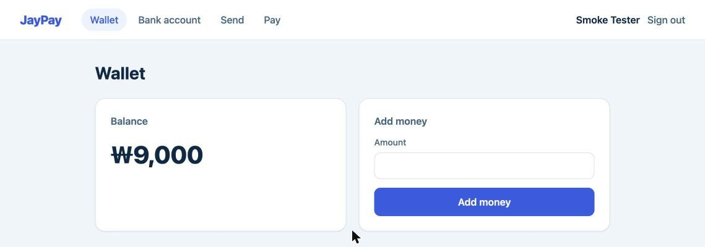
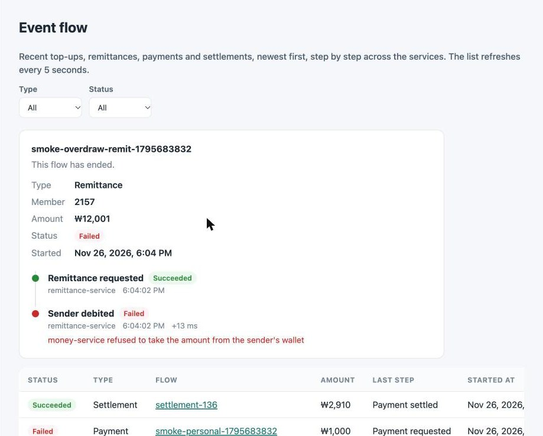
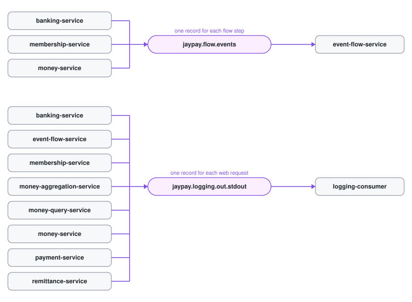
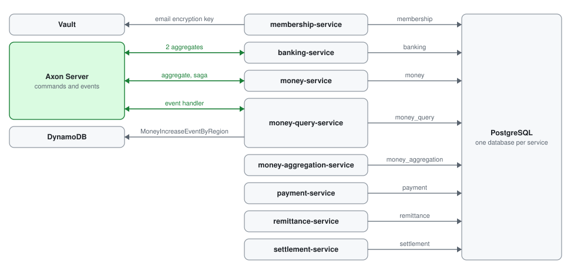

# JayPay

[](https://github.com/chrysaor/JayPay/actions/workflows/ci.yml?query=branch%3Adevelop)
[](https://github.com/chrysaor/JayPay/actions/workflows/security.yml?query=branch%3Adevelop)
[](https://github.com/chrysaor/JayPay/releases/latest)
[](LICENSE)

JayPay is a study project for a wallet-based payment service: members sign up, register a bank account, top up a wallet, send money and pay merchants, and a batch job settles the payments. The repository shows how to build that as Spring Boot services in a hexagonal layout and connect them with HTTP, Kafka and Axon Framework commands, events and sagas.

Around the services it ships two React sites behind one gateway, a Docker Compose stack and a local Kubernetes cluster that run the same workloads, logs, traces and metrics for every service, and one `make` gate that CI runs. The project started in 2023 and was rebuilt on Java 25 and Spring Boot 4. The documents from before the rebuild are in [docs/legacy](docs/legacy/README.md).

JayPay is not safe to run with real money or real users, see [Known limitations](#known-limitations).





The customer site after a top-up, and the event flow of the admin console showing a remittance that money-service refused.

## Contents

- [Quick start](#quick-start)
- [Architecture](#architecture)
- [Services](#services)
- [Observability](#observability)
- [Development](#development)
- [How it is built](#how-it-is-built)
- [Known limitations](#known-limitations)
- [Documents](#documents)

## Quick start

You need Docker, a JDK 21 or newer to run Gradle, and Python 3. Gradle downloads Java 25 itself. Node 24 or newer is needed only to build and test the frontend outside Docker. Run these from the repository root:

```sh
make images
make up
make smoke
make down
```

| Command | What it does |
| --- | --- |
| `make images` | Builds the image of every service, both sites and the gateway |
| `make up` | Writes `infra/docker/.env` with random secrets the first time, starts the Compose project `jaypay` and waits until every container is healthy |
| `make smoke` | Drives the stack end to end through both sites: sign-up, bank account, top-ups through the saga, a payment, the staff roles, and the logs, traces and metrics. It prints the cause and exits non-zero on the first failure |
| `make down` | Stops the stack and keeps its volumes |

Then open these. Every host port binds to `127.0.0.1`.

| What | Address |
| --- | --- |
| Customer site | http://localhost:8090 |
| Admin console | http://localhost:8091 |
| Grafana, view without a login | http://localhost:3030 |
| Keycloak admin console, user `admin` | http://localhost:8092 |

The admin console asks for a staff account. The first `make up` creates an admin, an operator and a viewer in the Keycloak realm `staff` from `STAFF_<ROLE>_USERNAME` and `STAFF_<ROLE>_PASSWORD` in `infra/docker/.env`. [infra/docker/README.md](infra/docker/README.md) lists every other address, every key of that file and what the smoke test checks step by step.

`make k8s-up`, `make k8s-smoke` and `make k8s-down` run the same stack on a local minikube cluster that Argo CD syncs from `deploy/envs/local`. They also need minikube and kubectl, see [deploy/README.md](deploy/README.md#local-cluster).

## Architecture

- Ten Spring Boot services. Nine have a host port and their own PostgreSQL database: eight of them serve HTTP endpoints and settlement-service runs a batch job. logging-consumer only consumes a Kafka topic.
- Two nginx containers serve the customer site and the admin console.
- One gateway, Envoy Gateway, is the entry of both sites and forwards `/api/<service>/...` to the services.
- Keycloak signs staff in for the admin console.

### Request path

The browser calls only its own site, and each site is a port of the gateway: 8090 for the customer site and 8091 for the admin console.

- The gateway strips `/api/<service>` and forwards the rest of the path to that service, for the methods and paths in the route table of the site. A path without a route gets the 404 of the site.
- For the admin console it first checks the Keycloak token: it answers 401 without a valid token and 403 when the role is not enough. It also passes the sign-in pages of the Keycloak realm `staff`, so the browser and the tokens see one origin.
- In the cluster it limits how many requests one address may send to the customer API.
- settlement-service starts its own requests from a batch job.


The services then call each other over HTTP. Each row is a caller, each column the service it calls, and each cell what the caller asks for.


[docs/api-contract.md](docs/api-contract.md) lists every endpoint, and `make verify` fails when the code no longer matches it.

### Messaging and storage

Kafka carries a log record for each web request and a record for each step of a saga top-up, which the admin console shows as the event flow.



Axon Server routes the commands and events of the money top-up saga and stores the events of the Axon aggregates.



`make diagrams` draws these four pictures from `deploy/envs/local/network-policy/calls.yaml`, `infra/docker/compose.yaml` and the service code, and `make verify` fails when a committed picture differs from what the script draws. [docs/architecture.md](docs/architecture.md) walks through the saga top-up step by step and shows the layers inside a service.

## Services

Every service and site has a section in [docs/services.md](docs/services.md) with what it does, its endpoints, data, calls, messaging, memory limit and configuration keys. The log topic is `jaypay.logging.out.stdout`, and the flow topic is `jaypay.flow.events`.

| Service | Role | Host port | Storage | Messaging |
| --- | --- | --- | --- | --- |
| [membership-service](docs/services.md#membership-service) | Sign up, look members up by id or address, edit members, issue and check member JWTs, and check the member of a saga top-up | 8081 | PostgreSQL `membership`, Vault for the key that encrypts member email | Axon command handler for the member check, writes the log and flow topics |
| [banking-service](docs/services.md#banking-service) | Register bank accounts and run firm banking requests against a fake bank | 8082 | PostgreSQL `banking` | Axon aggregates for bank accounts and firm banking, writes the log and flow topics |
| [money-service](docs/services.md#money-service) | Wallet balances and top-ups: synchronous or through the Axon saga | 8083 | PostgreSQL `money` | Axon aggregate and recharge saga, writes the log and flow topics |
| [remittance-service](docs/services.md#remittance-service) | Send money to a member or a bank account through money-service and banking-service | 8084 | PostgreSQL `remittance` | Writes the log topic |
| [payment-service](docs/services.md#payment-service) | Take payments from wallets to corporate merchants at a server-set fee, list paid payments, and mark each settled once | 8085 | PostgreSQL `payment` | Writes the log topic |
| [money-aggregation-service](docs/services.md#money-aggregation-service) | Sum the wallet balances of the members at one address | 8086 | PostgreSQL `money_aggregation`, no tables | Writes the log topic |
| [money-query-service](docs/services.md#money-query-service) | Read model of saga top-ups per address, read over HTTP | 8087 | DynamoDB `MoneyIncreaseEventByRegion`, PostgreSQL `money_query` with no tables | Axon event handler, writes the log topic |
| [settlement-service](docs/services.md#settlement-service) | Spring Batch job every 30 seconds that settles each paid payment once and pays its payout through firm banking | 8088 | PostgreSQL `settlement` for the batch tables | none |
| [event-flow-service](docs/services.md#event-flow-service) | Collects the steps of each saga top-up and serves the flows and their timelines to the admin console | 8093 | PostgreSQL `event_flow` | Kafka `jaypay.flow.events` in, writes the log topic |
| [logging-consumer](docs/services.md#logging-consumer) | Writes each record of the log topic to its own log | none | none | Kafka `jaypay.logging.out.stdout` in |
| [frontend-web](docs/services.md#frontend-web) | Customer site: nginx serves the React app | none | The session in the browser | none |
| [frontend-admin](docs/services.md#frontend-admin) | Admin console: nginx serves the React app | none | The staff tokens in the tab's memory | none |
| [gateway](docs/services.md#gateway) | Envoy Gateway: the entry of both sites. Routes, the staff token check and the role of each admin route, and the rate limits of the customer API in the cluster | 8090, 8091 | none | none |

Inside Compose every service listens on port 8080 and is reached by its service name, for example `http://membership-service:8080`. Actuator listens on the management port 9080, which no host port publishes.

| Area | Versions | Pinned in |
| --- | --- | --- |
| Backend | Java 25, Spring Boot 4.2.0, Axon Framework 4.13.3 | `backend/gradle/libs.versions.toml` |
| Frontend | React 19, Vite 8 | the `package.json` files under `frontend/` |
| Containers | Axon Server, Kafka, PostgreSQL, Keycloak and the others, by digest | `infra/docker/compose.yaml` |

[docs/components.md](docs/components.md) lists every component, what it is for and where its version is pinned.

## Observability

Every Spring Boot service sends its logs and traces to the OpenTelemetry Collector over OTLP HTTP, which writes them to ClickHouse. Prometheus scrapes the metrics every 10 seconds. Grafana reads both stores.

| Signal | Source | Store | Where to look |
| --- | --- | --- | --- |
| Logs | Logback through the OpenTelemetry appender | ClickHouse `otel.otel_logs`, kept 72 hours | Grafana dashboard **JayPay logs**, filtered by service, text or trace id |
| Traces | Micrometer Tracing across HTTP, Kafka and Axon | ClickHouse `otel.otel_traces`, kept 72 hours | Grafana dashboard **JayPay traces**, with the waterfall of one trace and its logs |
| Metrics | Micrometer, `/actuator/prometheus` on the management port 9080 | Prometheus, kept 3 days | Grafana dashboard **JayPay service overview**, the Grafana home page |

Each log record carries the trace id and span id of the request that wrote it, so a trace leads to its logs. The Collector drops the spans of `/actuator` requests. Container output is ECS JSON because Compose sets `LOG_FORMAT=ecs`.

## Development

Every command runs from the repository root. Run `make` to list all of them.

| Command | What it does |
| --- | --- |
| `make build`, `make test` | Compiles and tests the backend, with PostgreSQL through Testcontainers, and the frontend |
| `make verify` | Runs the gate that CI runs: `changelog contract docs english env terraform actionlint charts frontend backend`. `make verify STEPS="contract backend"` runs only the named steps |
| `make verify-selftest` | Plants errors and proves that the gate fails on each of them |
| `make e2e` | Drives both sites of the running stack in a browser |
| `make coverage`, `make scorecard` | Prints the line coverage, or writes [docs/scorecard.md](docs/scorecard.md) |
| `make scan`, `make scan-images` | Runs the Trivy and gitleaks scans, or the Trivy image scan |
| `make lock` | Refreshes every `gradle.lockfile` and `frontend/package-lock.json` after a version change |
| `make contract`, `make diagrams` | Regenerates `docs/api-contract.md` after an intended endpoint change, or `docs/diagrams/*.svg` after a change to the calls, `compose.yaml` or the Kafka and Axon code |
| `make release-branch VERSION=X.Y.Z` | Cuts `release/X.Y.Z` from `origin/develop` |

Docker must be running for `make test` and `make verify`. The terraform, actionlint, Helm, kubeconform, Trivy and gitleaks checks run from images pinned by digest, so you install none of them.

| Path | What it holds |
| --- | --- |
| `backend/` | Gradle 9 build: one directory per service in `services/`, the shared setup in `libs/common/`, the convention plugins in `build-logic/`, every dependency version in `gradle/libs.versions.toml` |
| `frontend/` | npm workspace with the two sites and their shared packages, see [frontend/README.md](frontend/README.md) |
| `infra/docker/` | `compose.yaml` and the configuration of every container in it, see [infra/docker/README.md](infra/docker/README.md) |
| `infra/terraform/` | The AWS DynamoDB table of money-query-service. One file defines the table for DynamoDB Local and for AWS, see [infra/terraform/README.md](infra/terraform/README.md) |
| `deploy/` | Helm charts and the values of every workload per environment, see [deploy/README.md](deploy/README.md) |
| `scripts/` | The scripts behind the `make` targets and the checks that `make verify` runs |
| `docs/` | The documents listed [below](#documents) |

`master` holds released code and `develop` is the integration branch. A change goes from `feature/<issue>-<name>` through a pull request into `develop`, a release from `release/X.Y.Z` through a pull request into `master` and the tag `vX.Y.Z`, which publishes the images to `ghcr.io/chrysaor/jaypay-<name>` and creates the GitHub Release. [CONTRIBUTING.md](CONTRIBUTING.md) has the branch table, the steps for a change, the release steps and the hotfix flow.

## How it is built

One maintainer develops JayPay with coding agents. The agents follow the rules in [CLAUDE.md](CLAUDE.md), and the maintainer decides what to build, answers the open decisions and confirms every release.

- Every change starts from an issue. An agent branches from `develop`, writes the failing test first, and opens a pull request that names the issue.
- `make verify` is the one gate. Agents run it before they report work as done, and CI runs the same target on every pull request.
- On every push to `develop` and to a release branch, CI also starts the Compose stack and runs `make smoke`, and `release.yml` publishes images only after that smoke passed.
- An agent merges its pull request into `develop` once CI passes. Merging into `master` and tagging a release need the maintainer's confirmation every time.
- A pull request that makes a decision adds a record to [docs/decisions](docs/decisions/README.md), and a bug that reached `develop` or took more than one attempt gets a retrospective in [docs/retrospectives](docs/retrospectives/README.md).

## Known limitations

JayPay is a study project and is not safe to run with real money or real users.

**Customers are not authenticated** ([#91](https://github.com/chrysaor/JayPay/issues/91))

- Login takes a member id only, with no password or other credential.
- The customer site forwards only the eleven requests its screens make and answers 404 to every other `/api/` path, but it forwards those without a login, so anyone can sign in as any member id, read any member and top up or spend any wallet.
- A top-up through the customer site adds up to 10000000 to any member's wallet without a bank withdrawal, and a payment and a remittance take the paying or sending member from the request body.

**Services trust the machine and the network**

- The service ports `127.0.0.1:8081` to `8088` and `8093` check no caller. Anyone on the machine can call a service directly, internal endpoints included.
- Actuator answers only on the management port 9080, which no host port publishes, but any container in the Compose network reaches it.

**Staff sign-in**

- Keycloak offers an authenticator app to every staff account but does not require one.
- Disabling a staff account in Keycloak stops its next sign-in at once, but an access token it already holds keeps working for up to 3 minutes.
- The local stack runs Keycloak over plain HTTP.

**Bank and settlement**

- The fake bank in banking-service accepts every account and every transfer to an account number that does not end in `-refused`, and forgets its answers when it restarts. A real bank has to deduplicate a transfer by its request id for a repeated request to stay safe.
- A bank transfer, a bank remittance or a payout that the bank does not answer waits until the same request is sent again or the next settlement run. Nothing retries a remittance in the background.
- A payout the bank refuses keeps its payment unsettled until the merchant registers another account, and the next settlement run then pays it to that account.

**Local dependencies**

- Vault runs in dev mode: it keeps the key in memory, unsealed, and writes it again from `ENCRYPTION_KEY` at every start, and its root token sits in `infra/docker/.env`.
- Grafana lets anyone on the machine view dashboards and query ClickHouse and Prometheus through them without a login.
- Kafka, Axon Server and DynamoDB Local take any client on their loopback ports without credentials.

[SECURITY.md](SECURITY.md) explains how to report a vulnerability and lists the CodeQL, Trivy, gitleaks and Dependabot checks and when each one runs. [Issue #53](https://github.com/chrysaor/JayPay/issues/53) tracks the endpoints and fixes that the two sites still need.

## Documents

| Document | What it answers |
| --- | --- |
| [docs/services.md](docs/services.md) | What each service and site does, with its endpoints, data, calls and configuration |
| [docs/architecture.md](docs/architecture.md) | How the saga top-up runs step by step, and the layers inside a service |
| [docs/api-contract.md](docs/api-contract.md) | Every HTTP endpoint |
| [docs/components.md](docs/components.md) | Every component, what it is for and where its version is pinned |
| [infra/docker/README.md](infra/docker/README.md) | The Compose stack: addresses, staff accounts, environment keys |
| [deploy/README.md](deploy/README.md) | The Helm charts, the gateway, the network policy, the local cluster and GitOps |
| [infra/terraform/README.md](infra/terraform/README.md) | The DynamoDB table on AWS: create it, point the service at it, destroy it |
| [CONTRIBUTING.md](CONTRIBUTING.md), [CLAUDE.md](CLAUDE.md) | Branches, the steps for a change and a release, and the rules that coding agents follow |
| [CHANGELOG.md](CHANGELOG.md), [docs/news.md](docs/news.md) | What each release changed, and each release summed up with the next milestones |
| [docs/decisions](docs/decisions/README.md), [docs/retrospectives](docs/retrospectives/README.md) | Why each decision was made and for which release, and what each bug taught |
| [docs/scorecard.md](docs/scorecard.md), [docs/test-audit.md](docs/test-audit.md) | Merged pull requests, CI failure rate and coverage, and which behaviour has a test |
| [SECURITY.md](SECURITY.md) | How to report a vulnerability, and the automated checks |
| [docs/legacy](docs/legacy/README.md) | The documents from before the rebuild |

## License

JayPay is released under the [MIT License](LICENSE).
