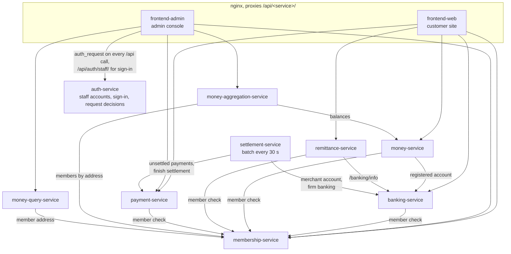
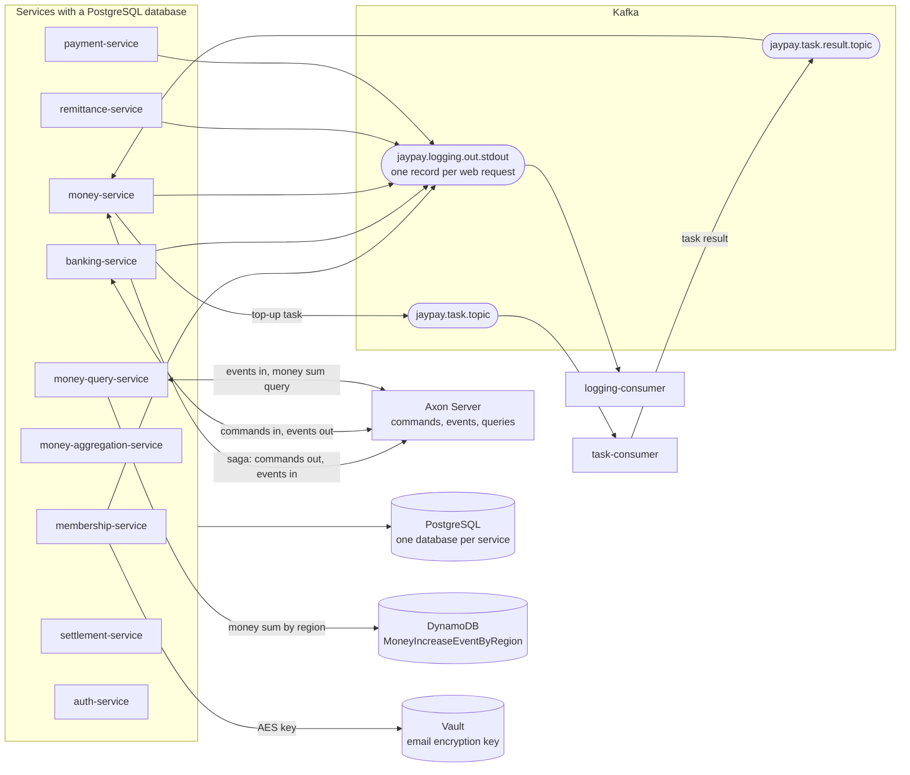
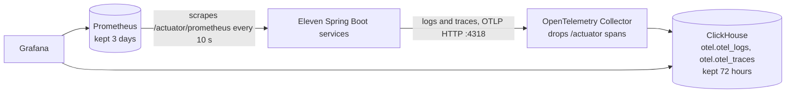
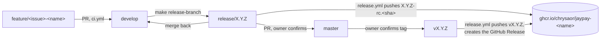

# JayPay

JayPay is a study project for a small payment service: members sign up, register a bank account, top up a wallet, send money and pay merchants, and a batch job settles the payments. The repository shows how to build that as Spring Boot services in a hexagonal layout and connect them with HTTP, Kafka and Axon Framework commands, events, sagas and queries. It also ships two React sites, a Docker Compose stack with logs, traces and metrics, and one `make` gate that CI runs. The project started in 2024 and was rebuilt on Java 25 and Spring Boot 4. The documents from before the rebuild are in [docs/legacy](docs/legacy/README.md).

## Architecture

Eleven Spring Boot services run in Docker Compose. Nine of them have a host port and their own PostgreSQL database. Eight of those nine serve the HTTP endpoints, and settlement-service runs a batch job instead. task-consumer and logging-consumer only consume Kafka topics. Two nginx containers serve the customer site and the admin console and proxy `/api/<service>/...` to the services. Before the admin console forwards a request, nginx asks auth-service whether the signed-in staff account may make it.

### Request path

The browser calls only its own site. nginx strips `/api/<service>` and forwards the rest of the path to that service. The services then call each other over HTTP. On the admin console, an `auth_request` to auth-service comes first: it answers 204 to let the request through, 401 without a valid staff token, and 403 when the role is not enough. No other service calls auth-service.



`docs/api-contract.md` lists every endpoint, and `make verify` fails when the code no longer matches it.

### Messaging and storage

Kafka carries the task top-up and a log line for each web request. Axon Server routes the commands, events and queries of the money top-up saga and stores the events of the Axon aggregates.



[docs/architecture.md](docs/architecture.md) walks through the saga top-up step by step and shows the layers inside a service. [docs/components.md](docs/components.md) lists every component, what it is for and where its version is pinned.

## Repository layout

| Path | What it holds |
| --- | --- |
| `backend/` | Gradle 9 build: `services/` with one directory per service, `libs/common/` with the shared Kafka, Axon, HTTP client and observability setup, `tools/utility/` with dummy data generators, `build-logic/` with the convention plugins, and one `Dockerfile` for every service image |
| `backend/gradle/libs.versions.toml` | Every backend dependency version |
| `frontend/` | npm workspace with the two sites and their shared packages, see [frontend/README.md](frontend/README.md) |
| `infra/docker/` | `compose.yaml` for the local stack and the configuration of every container in it, see [infra/docker/README.md](infra/docker/README.md) |
| `infra/terraform/` | The AWS DynamoDB table that money-query-service uses, see [infra/terraform/README.md](infra/terraform/README.md) |
| `deploy/` | Helm charts for the services, the two sites and the dependencies of the local cluster, and the values of every workload per environment, see [deploy/README.md](deploy/README.md) |
| `scripts/` | `verify.sh` behind `make verify`, `smoke.sh` behind `make smoke` and `make k8s-smoke`, `k8s.sh` behind the `make k8s-*` targets, `init-env.py` that writes `infra/docker/.env`, `render-charts.sh` that renders every workload, and the checks that `make verify` runs |
| `docs/` | The HTTP API contract, the architecture notes, and the [legacy documents](docs/legacy/README.md) |

## Quick start

You need Docker, a JDK 21 or newer to run Gradle, and Python 3. Gradle downloads Java 25 itself. Node 24 is needed only to build and test the frontend outside Docker.

Run these from the repository root:

```sh
make images
make up
make smoke
```

1. `make images` builds `jaypay/<service>` for every backend service, and `jaypay/frontend-web` and `jaypay/frontend-admin`.
2. `make up` writes `infra/docker/.env` with random secrets the first time, starts the Compose project `jaypay`, and waits until every container is healthy. The first start also builds the OpenTelemetry Collector image.
3. `make smoke` signs a member up through the customer site, registers a bank account, tops the wallet up through the saga and through the Kafka task, pays, signs the three staff roles in to the admin console and checks what each may do, and checks that logs, traces and metrics arrived. It prints the cause and exits non-zero on the first failure.

Stop the stack with `make down`.

Every host port binds to `127.0.0.1`.

| What | Address |
| --- | --- |
| Customer site | http://localhost:8090 |
| Admin console | http://localhost:8091 |
| Grafana, no login | http://localhost:3030 |
| Prometheus | http://localhost:9090 |
| Kafka UI | http://localhost:8989 |
| Axon Server dashboard | http://localhost:8024 |
| Axon Server gRPC | `localhost:8124` |
| ClickHouse HTTP, user `otel` | http://localhost:8123 |
| Vault, dev mode | http://localhost:8200 |
| DynamoDB Local | http://localhost:8000 |
| PostgreSQL, user `jaypay` | `localhost:5432` |
| Kafka | `localhost:9092` |
| OTLP gRPC and HTTP | `localhost:4317`, `localhost:4318` |
| Services | `localhost:8081` to `localhost:8089`, listed in the next table, with Swagger UI at `/swagger-ui.html` |

The passwords are in `infra/docker/.env`. [infra/docker/README.md](infra/docker/README.md) describes every key in it. The admin console asks for a staff account: `make up` creates an admin, an operator and a viewer from `STAFF_<ROLE>_USERNAME` and `STAFF_<ROLE>_PASSWORD` in that file.

## Services

| Service | Host port | Responsibility | Storage and messaging |
| --- | --- | --- | --- |
| membership-service | 8081 | Sign up, look members up by id or address, edit members, and issue and check JWTs | PostgreSQL `membership`, Vault for the key that encrypts member email |
| banking-service | 8082 | Register bank accounts and run firm banking requests against a fake bank | PostgreSQL `banking`, Axon aggregates for bank accounts and firm banking |
| money-service | 8083 | Wallet balances and top-ups: synchronous, through a Kafka task, or through the Axon saga | PostgreSQL `money`, Axon aggregate and recharge saga, Kafka task topics |
| remittance-service | 8084 | Send money to a member or a bank account, and keep the history | PostgreSQL `remittance` |
| payment-service | 8085 | Record payments to merchants, list unsettled payments, and mark them settled | PostgreSQL `payment` |
| money-aggregation-service | 8086 | Sum the wallet balances of the members at one address | PostgreSQL `money_aggregation` |
| money-query-service | 8087 | Read model of top-ups per region, answered through an Axon query | PostgreSQL `money_query`, DynamoDB `MoneyIncreaseEventByRegion`, Axon event handler and query handler |
| settlement-service | 8088 | Spring Batch job every 30 seconds that pays merchants their share through firm banking and marks the payments settled | PostgreSQL `settlement` for the batch tables |
| auth-service | 8089 | Staff accounts with the roles viewer, operator and admin, the password rules, sign-in, staff tokens, and the decision for every admin console request | PostgreSQL `auth` |
| task-consumer | none | Reads top-up tasks, marks every subtask done, and writes the result | Kafka `jaypay.task.topic` in, `jaypay.task.result.topic` out |
| logging-consumer | none | Writes each message from the logging topic to its own log | Kafka `jaypay.logging.out.stdout` in |

Inside Compose every service listens on port 8080 and is reached by its service name, for example `http://membership-service:8080`.

The stack pins Java 25, Spring Boot 4.2.0 and Axon Framework 4.13.3 in `backend/gradle/libs.versions.toml`, and React 19 with Vite 8 in the frontend packages. Axon Server, Kafka, PostgreSQL and the other containers are pinned by digest in `infra/docker/compose.yaml`.

## Observability

Every Spring Boot service sends its logs and traces to the OpenTelemetry Collector over OTLP HTTP. Prometheus scrapes the metrics. Grafana reads both stores.



| Signal | Source | Store | Where to look |
| --- | --- | --- | --- |
| Logs | Logback through the OpenTelemetry appender | ClickHouse `otel.otel_logs` | Grafana dashboard **JayPay logs**, filtered by service, text or trace id |
| Traces | Micrometer Tracing across HTTP, Kafka and Axon | ClickHouse `otel.otel_traces` | Grafana dashboard **JayPay traces**, with the waterfall of one trace and its logs |
| Metrics | Micrometer, `/actuator/prometheus` | Prometheus | Grafana dashboard **JayPay service overview**, the Grafana home page |

Each log record carries the trace id and span id of the request that wrote it, so a trace leads to its logs. Container output is ECS JSON because Compose sets `LOG_FORMAT=ecs`.

## Development

Every command runs from the repository root. Run `make` to list them.

| Command | What it does |
| --- | --- |
| `make build` | Compiles the backend and builds the frontend |
| `make test` | Runs the backend tests, with PostgreSQL through Testcontainers, and the frontend tests |
| `make verify` | Runs the gate that CI runs: `contract english env terraform actionlint charts frontend backend` |
| `make verify STEPS="contract backend"` | Runs only the named steps |
| `make verify-selftest` | Proves that the gate fails on planted errors |
| `make images` | Builds every service image and both frontend images |
| `make up`, `make down` | Starts the local stack and waits until it is healthy, or stops it |
| `make smoke` | Drives the running stack end to end |
| `make k8s-up`, `make k8s-smoke`, `make k8s-down` | Runs the same stack on a local minikube cluster, drives it through its ingress, or deletes the cluster, see [deploy/README.md](deploy/README.md#local-cluster) |
| `make scan`, `make scan-images` | Runs the Trivy and gitleaks scans, or the Trivy image scan |
| `make lock` | Refreshes every `gradle.lockfile` and `frontend/package-lock.json` after a version change |
| `make contract` | Regenerates `docs/api-contract.md` after an intended endpoint change |
| `make release-branch VERSION=X.Y.Z` | Creates `release/X.Y.Z` from `origin/develop` |

Docker must be running for `make test` and `make verify`. The terraform, actionlint, Helm, kubeconform, Trivy and gitleaks checks run from images pinned by digest, so you install none of them. The `make k8s-*` targets also need minikube and kubectl.

### Branches and releases

`master` holds released code and `develop` is the integration branch. Every change reaches them through a pull request.



[CONTRIBUTING.md](CONTRIBUTING.md) has the branch table, the steps for a change, the release steps and the hotfix flow. [CLAUDE.md](CLAUDE.md) has the rules that coding agents follow in this repository.

### Security

[SECURITY.md](SECURITY.md) explains how to report a vulnerability and lists the CodeQL, Trivy, gitleaks and Dependabot checks and when each one runs.

### AWS

The local stack uses DynamoDB Local and keeps its data in a volume. One file, `infra/terraform/modules/dynamodb-money-sum/table.json`, defines the table for both DynamoDB Local and AWS. [infra/terraform/README.md](infra/terraform/README.md) creates the real table for money-query-service, points the service at it and destroys it again, running Terraform from its official image. money-query-service takes the table name from `DYNAMODB_TABLE_NAME` and the region from `AWS_REGION`, `ap-northeast-2` by default.

## Known limitations

JayPay is a study project and is not safe to run with real money or real users.

- The admin console checks staff accounts, but the service ports `127.0.0.1:8081` to `8089` and the customer site do not. Anyone on the machine can call a service directly, and the customer site still forwards member edits and Mark settled without a login.
- Staff sign-in takes a password only. The MFA flag on an account is stored and shown but does not change sign-in yet, and nothing limits how often someone may try a password.
- An admin cannot reset another account's password. Deactivate the account and create a new one instead.
- Login takes a member id only, with no password or other credential.
- The fake bank in banking-service accepts every account and every transfer.
- remittance-service does not move money yet. Its money-service client returns no data, so a remittance request fails.
- The local stack runs Vault in dev mode and gives Grafana anonymous edit access.

[Issue #53](https://github.com/chrysaor/JayPay/issues/53) tracks the endpoints and fixes that the two sites still need.
