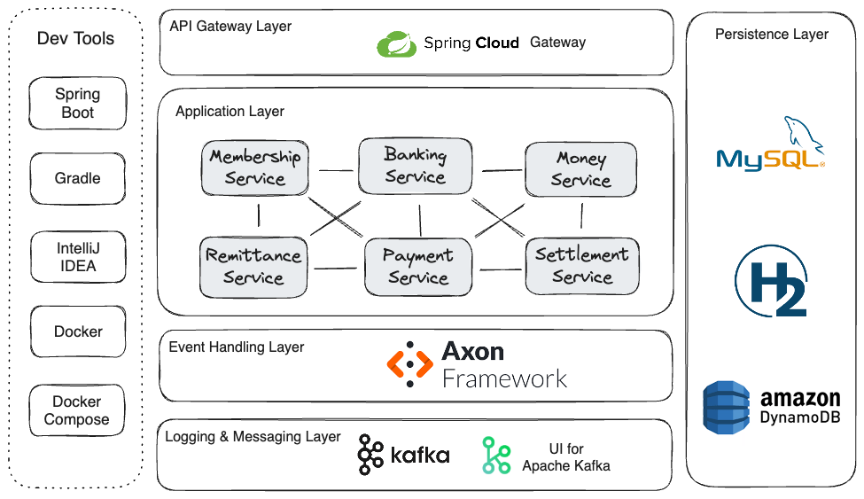
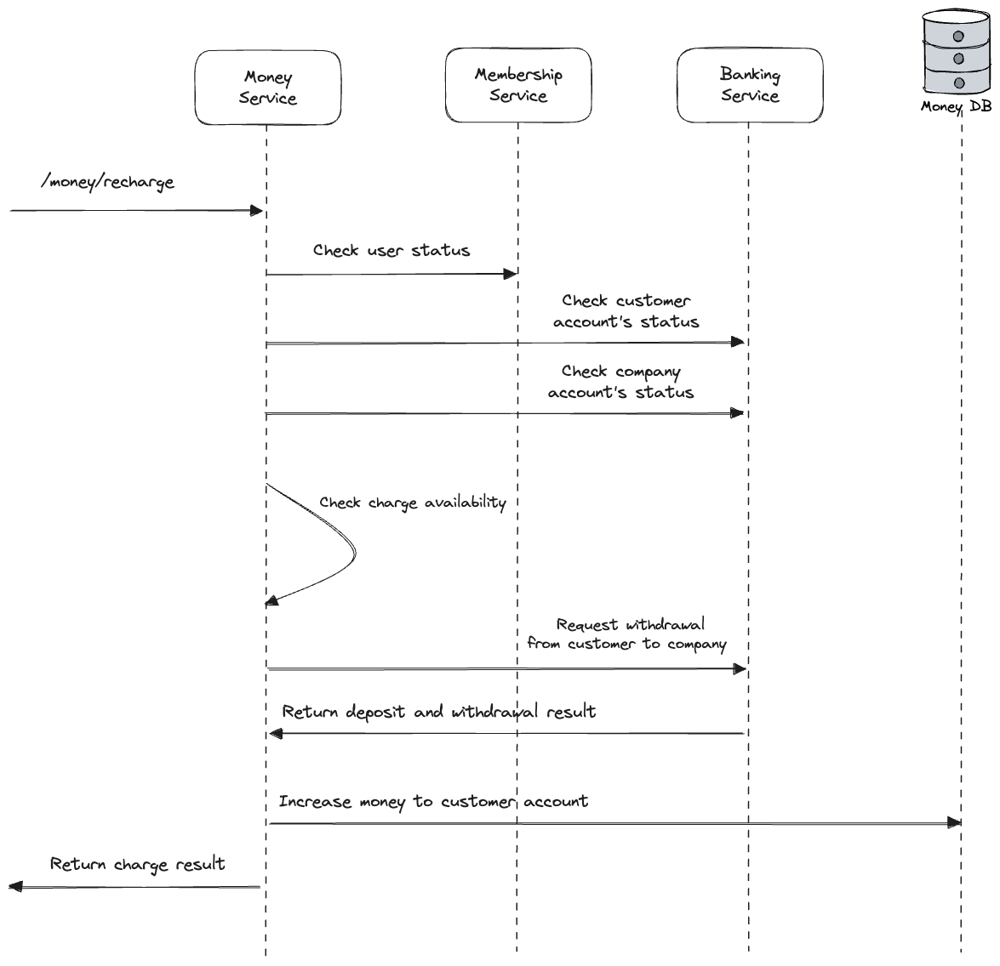

# JayPay Project Overview


```
It consists of six services: Membership, Banking, Money, Remittance, Payment, and Settlement, each configured as an independent project.
Each service implemented basic functionalities using Hexagonal Architecture, and then incorporates features such as EDA, CQRS, Event Sourcing, and the Saga Pattern.

The projects are primarily based on Spring Boot 4 and Java 25, and the Axon Framework v4.13 is used to implement EDA.
```

## Using Stack in this project
- Java 25
- Spring Boot 4, Spring Data JPA, Spring Batch
- Lombok
- Gradle 9 (version catalog, convention plugins, dependency locking)
- JWT
- Axon Framework 4
- Docker, Docker Compose
- PostgreSQL
- AWS DynamoDB

## Repository layout
```
backend/            Gradle build root
  build-logic/      convention plugins (jaypay.java, jaypay.service, jaypay.jpa-service)
  gradle/libs.versions.toml
  libs/common/
  services/         one directory per Spring Boot service
  tools/utility/    dummy data generators
  Dockerfile        one image recipe for every service
infra/docker/       compose.yaml, .env.example, PostgreSQL init scripts
docs/               diagrams and the HTTP API contract
scripts/            verify.sh, verify-selftest.sh, extract-endpoints.py
Makefile            the single entry point for build, test, verify, images and the local stack
```

## Sequence Diagram Examples

### Membership service


### Banking service


### Money service


### Remittance service


### Payment service


### Settlement service


## Build, test and run
Every command runs from the repository root. Run `make` to list them. Docker must be running.

| Command | What it does |
| --- | --- |
| `make build` | Compiles the backend and builds the frontend |
| `make test` | Runs backend tests (PostgreSQL through Testcontainers) and frontend tests |
| `make verify` | The gate CI runs: contract diff, English-only and env checks, terraform, actionlint, frontend, backend |
| `make images` | Builds `jaypay/<service>` for every service, `jaypay/frontend-web` and `jaypay/frontend-admin` |
| `make up` / `make down` | Starts the stack in `infra/docker` and waits until it is healthy, or stops it |
| `make smoke` | Drives the running stack end to end, see [infra/docker/README.md](infra/docker/README.md) |
| `make scan`, `make scan-images` | Trivy and gitleaks, see [SECURITY.md](SECURITY.md) |
| `make lock` | Refreshes every `gradle.lockfile` and `frontend/package-lock.json` after a version change |
| `make contract` | Regenerates `docs/api-contract.md` after an intended endpoint change |

Run `make images` before `make up`. The first `make up` writes `infra/docker/.env` from `.env.example` with random secrets. The file is git-ignored.

`docs/api-contract.md` lists every HTTP endpoint, and `make verify` fails when the code no longer matches it.

See [CONTRIBUTING.md](CONTRIBUTING.md) for the branch, PR and release flow, and [CLAUDE.md](CLAUDE.md) for the rules agents follow.

## Service Endpoint & Swagger UI
- Membership Service
  - http://localhost:8081/memberships
  - http://localhost:8081/swagger-ui.html
- Banking Service
  - http://localhost:8082/banking
  - http://localhost:8082/swagger-ui.html
- Money Service
  - http://localhost:8083/money
  - http://localhost:8083/swagger-ui.html
- Remittance Service
  - http://localhost:8084/remittance
  - http://localhost:8084/swagger-ui.html
- Payment Service
  - http://localhost:8085/payment
  - http://localhost:8085/swagger-ui.html
- Money Aggregation Service
  - http://localhost:8086/money/aggregation
  - http://localhost:8086/swagger-ui.html
- Money Query Service
  - http://localhost:8087/money/query
  - http://localhost:8087/swagger-ui.html
- Settlement Service
  - http://localhost:8088/settlement
  - http://localhost:8088/swagger-ui.html  
- PostgreSQL
  - localhost:5432
  - database: jaypay
  - user/password: `POSTGRES_USER` / `POSTGRES_PASSWORD` from `infra/docker/.env`
- Kafka UI
  - http://localhost:8989
- Axon Server Dashboard
  - http://localhost:8024

## Trouble Shooting
### 1. It needs connection information to use dynamo db.
money-query-service uses the AWS SDK default credentials chain. Set `AWS_ACCESS_KEY_ID` and `AWS_SECRET_ACCESS_KEY` in the environment that runs it.