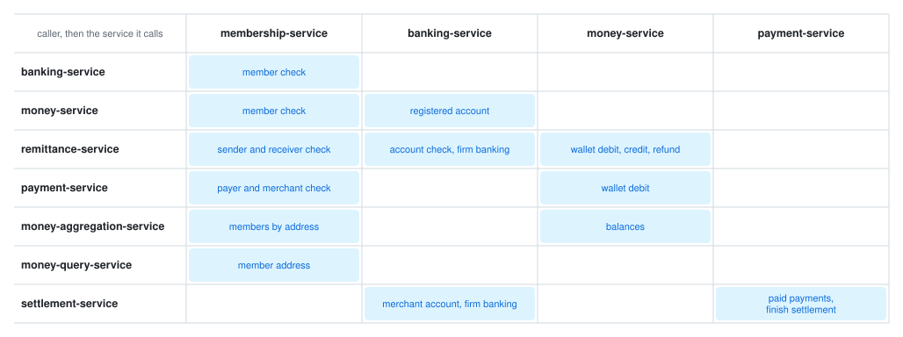
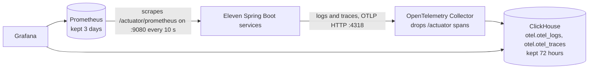
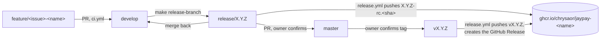

# JayPay

[](https://github.com/chrysaor/JayPay/actions/workflows/ci.yml?query=branch%3Adevelop)
[](https://github.com/chrysaor/JayPay/actions/workflows/security.yml?query=branch%3Adevelop)
[](https://github.com/chrysaor/JayPay/releases/latest)
[](LICENSE)

JayPay is a study project for a wallet-based payment service: members sign up, register a bank account, top up a wallet, send money and pay merchants, and a batch job settles the payments. The repository shows how to build that as Spring Boot services in a hexagonal layout and connect them with HTTP, Kafka and Axon Framework commands, events and sagas. It also ships two React sites, a Docker Compose stack with logs, traces and metrics, and one `make` gate that CI runs. The project started in 2023 and was rebuilt on Java 25 and Spring Boot 4. The documents from before the rebuild are in [docs/legacy](docs/legacy/README.md).

## Quick start

You need Docker, a JDK 21 or newer to run Gradle, and Python 3. Gradle downloads Java 25 itself. Node 24 or newer is needed only to build and test the frontend outside Docker. Run these from the repository root:

```sh
make images
make up
make smoke
make down
```

`make images` builds every image, and `make up` starts the stack and waits until it is healthy. Then open the customer site at http://localhost:8090 and the admin console at http://localhost:8091, which asks for a staff account from `infra/docker/.env`. `make smoke` drives the stack end to end, and `make down` stops it. [Local stack](#local-stack) explains each step and lists every address.

## Screens

The customer site after a top-up, and the event flow of the admin console showing a remittance that money-service refused.


## How it is built

One maintainer develops JayPay with coding agents. The agents follow the rules in [CLAUDE.md](CLAUDE.md), and the maintainer decides what to build, answers the open decisions and confirms every release.

- Every change starts from an issue. An agent branches from `develop`, writes the failing test first, and opens a pull request that names the issue.
- `make verify` is the one gate. Agents run it before they report work as done, and CI runs the same target on every pull request. `make verify-selftest` plants errors and proves that the gate fails on each of them.
- An agent merges its pull request into `develop` once CI passes. Merging into `master` and tagging a release need the maintainer's confirmation every time.
- A pull request that makes a decision adds a record to [docs/decisions](docs/decisions/README.md), and a bug that reached `develop` or took more than one attempt gets a retrospective in [docs/retrospectives](docs/retrospectives/README.md).
- [docs/scorecard.md](docs/scorecard.md) shows merged pull requests, time to merge, the CI failure rate, coverage and tests, each with its source and what it does not measure.

## Architecture

Eleven Spring Boot services run in Docker Compose. Ten of them have a host port, and nine of those ten have their own PostgreSQL database. Nine of the ten serve HTTP endpoints, and settlement-service runs a batch job instead. logging-consumer only consumes a Kafka topic. Two nginx containers serve the customer site and the admin console and proxy `/api/<service>/...` to the services. Staff sign in to the admin console through Keycloak, and before the admin console forwards a request, nginx asks auth-service whether the staff token's role may make it.

### Request path

The browser calls only its own site. nginx strips `/api/<service>` and forwards the rest of the path to that service. On the admin console, an `auth_request` to auth-service comes first: it answers 204 to let the request through, 401 without a valid Keycloak token, and 403 when the role is not enough. The admin site also proxies the sign-in pages of the Keycloak realm `staff`, so the browser and the tokens see one origin. No other service calls auth-service. settlement-service starts its own requests from a batch job.


The services then call each other over HTTP. Each row is a caller, each column the service it calls, and each cell what the caller asks for.



`docs/api-contract.md` lists every endpoint, and `make verify` fails when the code no longer matches it.

### Messaging and storage

Kafka carries a log record for each web request and a record for each step of a saga top-up, which the admin console shows as the event flow.


Axon Server routes the commands and events of the money top-up saga and stores the events of the Axon aggregates. Every service with a host port has its own PostgreSQL database.


`make diagrams` draws these four pictures with `scripts/check-docs.py` from `deploy/envs/local/network-policy/calls.yaml`, `infra/docker/compose.yaml` and the service code. `make verify` fails when a committed picture differs from what the script draws.

[docs/architecture.md](docs/architecture.md) walks through the saga top-up step by step and shows the layers inside a service. [docs/components.md](docs/components.md) lists every component, what it is for and where its version is pinned.

## Repository layout

| Path | What it holds |
| --- | --- |
| `backend/` | Gradle 9 build: `services/` with one directory per service, `libs/common/` with the shared Kafka, Axon, HTTP client and observability setup, `tools/utility/` with dummy data generators, `build-logic/` with the convention plugins, and one `Dockerfile` for every service image |
| `backend/gradle/libs.versions.toml` | Every backend dependency version |
| `frontend/` | npm workspace with the two sites and their shared packages, see [frontend/README.md](frontend/README.md) |
| `infra/docker/` | `compose.yaml` for the local stack and the configuration of every container in it, see [infra/docker/README.md](infra/docker/README.md) |
| `infra/terraform/` | The AWS DynamoDB table that money-query-service uses, see [infra/terraform/README.md](infra/terraform/README.md) |
| `deploy/` | Helm charts for the services, the two sites and the dependencies of the local cluster, and the values of every workload per environment, see [deploy/README.md](deploy/README.md) |
| `scripts/` | `verify.sh` behind `make verify`, `smoke.sh` behind `make smoke` and `make k8s-smoke`, `k8s.sh` behind the `make k8s-*` targets, `init-env.py` that writes `infra/docker/.env`, `render-charts.sh` that renders every workload, `check-docs.py` that draws `docs/diagrams/`, and the checks that `make verify` runs |
| `docs/` | The HTTP API contract, the [service reference](docs/services.md), the diagrams, the architecture notes, the [decision records](docs/decisions/README.md), the [retrospectives](docs/retrospectives/README.md), the [news of each release](docs/news.md), and the [legacy documents](docs/legacy/README.md) |

## Local stack

1. `make images` builds `jaypay/<service>` for every backend service, and `jaypay/frontend-web` and `jaypay/frontend-admin`.
2. `make up` writes `infra/docker/.env` with random secrets the first time, starts the Compose project `jaypay`, and waits until every container is healthy. The first start also builds the OpenTelemetry Collector image.
3. `make smoke` signs a member up through the customer site, registers a bank account, tops the wallet up through the saga, checks that a saga top-up of a member membership-service does not know fails, checks that the admin console shows each top-up as an event flow with its steps and the step that failed, pays, signs the three staff roles in to the admin console through the Keycloak Authorization Code flow and checks what each may do, checks that a disabled or locked Keycloak account cannot sign in, and checks that logs, traces and metrics arrived. It prints the cause and exits non-zero on the first failure.

Stop the stack with `make down`.

Every host port binds to `127.0.0.1`.

| What | Address |
| --- | --- |
| Customer site | http://localhost:8090 |
| Admin console | http://localhost:8091 |
| Keycloak admin console, user `admin` | http://localhost:8092 |
| Grafana, view without a login | http://localhost:3030 |
| Prometheus | http://localhost:9090 |
| Kafka UI | http://localhost:8989 |
| Axon Server dashboard | http://localhost:8024 |
| Axon Server gRPC | `localhost:8124` |
| ClickHouse HTTP, user `otel` | http://localhost:8123 |
| Vault, dev mode | http://localhost:8200 |
| DynamoDB Local | http://localhost:8000 |
| PostgreSQL, user `jaypay` | `localhost:5432` |
| Kafka | `localhost:9092` |
| OTLP gRPC and HTTP | `localhost:4317`, `localhost:4318` |
| Services | `localhost:8081` to `localhost:8089`, listed in the next table. Actuator listens on port 9080 inside the container, which no host port publishes |

The passwords are in `infra/docker/.env`. [infra/docker/README.md](infra/docker/README.md) describes every key in it. The admin console asks for a staff account: the first `make up` imports the Keycloak realm `staff` with an admin, an operator and a viewer from `STAFF_<ROLE>_USERNAME` and `STAFF_<ROLE>_PASSWORD` in that file. Staff accounts are managed in the Keycloak admin console.

## Services

Every service and site has a section in [docs/services.md](docs/services.md) with what it does, its endpoints, data, calls, messaging, memory limit and configuration keys. The log topic is `jaypay.logging.out.stdout`: seven services write one record to it for each web request.

| Service | Role | Host port | Storage | Messaging |
| --- | --- | --- | --- | --- |
| [membership-service](docs/services.md#membership-service) | Sign up, look members up by id or address, edit members, issue and check member JWTs, and check the member of a saga top-up | 8081 | PostgreSQL `membership`, Vault for the key that encrypts member email | Axon command handler for the member check, writes the log and flow topics |
| [banking-service](docs/services.md#banking-service) | Register bank accounts and run firm banking requests against a fake bank | 8082 | PostgreSQL `banking` | Axon aggregates for bank accounts and firm banking, writes the log and flow topics |
| [money-service](docs/services.md#money-service) | Wallet balances and top-ups: synchronous or through the Axon saga | 8083 | PostgreSQL `money` | Axon aggregate and recharge saga, writes the log and flow topics |
| [remittance-service](docs/services.md#remittance-service) | Send money to a member or a bank account through money-service and banking-service | 8084 | PostgreSQL `remittance` | Writes the log topic |
| [payment-service](docs/services.md#payment-service) | Take payments from wallets to corporate merchants at a server-set fee, list paid payments, and mark each settled once | 8085 | PostgreSQL `payment` | Writes the log topic |
| [money-aggregation-service](docs/services.md#money-aggregation-service) | Sum the wallet balances of the members at one address | 8086 | PostgreSQL `money_aggregation`, no tables | Writes the log topic |
| [money-query-service](docs/services.md#money-query-service) | Read model of saga top-ups per address, read over HTTP | 8087 | DynamoDB `MoneyIncreaseEventByRegion`, PostgreSQL `money_query` with no tables | Axon event handler, writes the log topic |
| [settlement-service](docs/services.md#settlement-service) | Spring Batch job every 30 seconds that settles each paid payment once and pays its payout through firm banking | 8088 | PostgreSQL `settlement` for the batch tables | none |
| [event-flow-service](docs/services.md#event-flow-service) | Collects the steps of each saga top-up and serves the flows and their timelines to the admin console | 8093 | PostgreSQL `event_flow` | Kafka `jaypay.flow.events` in, writes the log topic |
| [auth-service](docs/services.md#auth-service) | The decision for every admin console request from the Keycloak token's realm role: viewer, operator or admin | 8089 | none | none |
| [logging-consumer](docs/services.md#logging-consumer) | Writes each record of the log topic to its own log | none | none | Kafka `jaypay.logging.out.stdout` in |
| [frontend-web](docs/services.md#frontend-web) | Customer site: nginx serves the React app and proxies `/api/<service>/` to five services | 8090 | The session in the browser | none |
| [frontend-admin](docs/services.md#frontend-admin) | Admin console: nginx serves the React app, proxies the Keycloak sign-in, asks auth-service, and proxies to five services | 8091 | The staff tokens in the tab's memory | none |

Inside Compose every service listens on port 8080 and is reached by its service name, for example `http://membership-service:8080`.

The stack pins Java 25, Spring Boot 4.2.0 and Axon Framework 4.13.3 in `backend/gradle/libs.versions.toml`, and React 19 with Vite 8 in the frontend packages. Axon Server, Kafka, PostgreSQL and the other containers are pinned by digest in `infra/docker/compose.yaml`.

## Observability

Every Spring Boot service sends its logs and traces to the OpenTelemetry Collector over OTLP HTTP. Prometheus scrapes the metrics. Grafana reads both stores.



| Signal | Source | Store | Where to look |
| --- | --- | --- | --- |
| Logs | Logback through the OpenTelemetry appender | ClickHouse `otel.otel_logs` | Grafana dashboard **JayPay logs**, filtered by service, text or trace id |
| Traces | Micrometer Tracing across HTTP, Kafka and Axon | ClickHouse `otel.otel_traces` | Grafana dashboard **JayPay traces**, with the waterfall of one trace and its logs |
| Metrics | Micrometer, `/actuator/prometheus` on the management port 9080 | Prometheus | Grafana dashboard **JayPay service overview**, the Grafana home page |

Each log record carries the trace id and span id of the request that wrote it, so a trace leads to its logs. Container output is ECS JSON because Compose sets `LOG_FORMAT=ecs`.

## Development

Every command runs from the repository root. Run `make` to list them.

| Command | What it does |
| --- | --- |
| `make build` | Compiles the backend and builds the frontend |
| `make test` | Runs the backend tests, with PostgreSQL through Testcontainers, and the frontend tests |
| `make coverage` | Prints the line coverage of the backend and of each frontend app. CI writes the same table to the summary of its backend and frontend jobs |
| `make scorecard` | Writes `docs/scorecard.md`: merged PRs, time to merge, CI failure rate, releases, coverage, tests, smoke scenes and issues, each with its source and what it does not measure |
| `make verify` | Runs the gate that CI runs: `changelog contract docs english env terraform actionlint charts frontend backend` |
| `make verify STEPS="contract backend"` | Runs only the named steps |
| `make verify-selftest` | Proves that the gate fails on planted errors |
| `make images` | Builds every service image and both frontend images |
| `make up`, `make down` | Starts the local stack and waits until it is healthy, or stops it |
| `make smoke` | Drives the running stack end to end |
| `make k8s-up`, `make k8s-smoke`, `make k8s-down` | Runs the same stack on a local minikube cluster, drives it through its ingress, or deletes the cluster, see [deploy/README.md](deploy/README.md#local-cluster) |
| `make scan`, `make scan-images` | Runs the Trivy and gitleaks scans, or the Trivy image scan |
| `make lock` | Refreshes every `gradle.lockfile` and `frontend/package-lock.json` after a version change |
| `make dependencies` | Downloads the backend dependencies and retries when the repository refuses, which CI runs before the build |
| `make contract` | Regenerates `docs/api-contract.md` after an intended endpoint change |
| `make diagrams` | Redraws `docs/diagrams/*.svg` after a change to the calls, `compose.yaml` or the Kafka and Axon code |
| `make release-branch VERSION=X.Y.Z` | Creates `release/X.Y.Z` from `origin/develop` with a commit that sets the version and turns Unreleased in `CHANGELOG.md` into X.Y.Z |

Docker must be running for `make test` and `make verify`. The terraform, actionlint, Helm, kubeconform, Trivy and gitleaks checks run from images pinned by digest, so you install none of them. The `make k8s-*` targets also need minikube and kubectl.

### Branches and releases

`master` holds released code and `develop` is the integration branch. Every change reaches them through a pull request.



[CHANGELOG.md](CHANGELOG.md) says what each release added and changed. [docs/news.md](docs/news.md) sums up each release with its decisions, retrospectives and new documents, and lists the next milestones. [docs/decisions](docs/decisions/README.md) records why each decision was made and for which release, and [docs/retrospectives](docs/retrospectives/README.md) what each bug taught. [CONTRIBUTING.md](CONTRIBUTING.md) has the branch table, the steps for a change, the release steps and the hotfix flow. [CLAUDE.md](CLAUDE.md) has the rules that coding agents follow in this repository.

### Security

[SECURITY.md](SECURITY.md) explains how to report a vulnerability and lists the CodeQL, Trivy, gitleaks and Dependabot checks and when each one runs.

### AWS

The local stack uses DynamoDB Local and keeps its data in a volume. One file, `infra/terraform/modules/dynamodb-money-sum/table.json`, defines the table for both DynamoDB Local and AWS. [infra/terraform/README.md](infra/terraform/README.md) creates the real table for money-query-service, points the service at it and destroys it again, running Terraform from its official image. money-query-service takes the table name from `DYNAMODB_TABLE_NAME` and the region from `AWS_REGION`, `ap-northeast-2` by default.

## Known limitations

JayPay is a study project and is not safe to run with real money or real users.

- The admin console checks staff accounts, but the service ports `127.0.0.1:8081` to `8089` and the customer site do not. Anyone on the machine can call a service directly, internal endpoints included. Actuator answers only on the management port 9080, which no host port publishes, but any container in the Compose network reaches it. The customer site forwards only the eleven requests its screens make and answers 404 to every other `/api/` path, but it forwards those without a login, so anyone can sign in as any member id, read any member and top up or spend any wallet.
- Keycloak offers an authenticator app to every staff account but does not require one.
- Disabling a staff account in Keycloak stops its next sign-in at once, but an access token it already holds keeps working for up to 3 minutes.
- The local stack runs Keycloak over plain HTTP.
- Login takes a member id only, with no password or other credential.
- The fake bank in banking-service accepts every account and every transfer to an account number that does not end in `-refused`, and forgets its answers when it restarts. A real bank has to deduplicate a transfer by its request id for a repeated request to stay safe.
- A bank transfer, a bank remittance or a payout that the bank does not answer waits until the same request is sent again or the next settlement run. Nothing retries a remittance in the background.
- The saga top-up deadline lives in the memory of one money-service instance. A restart drops it, and a top-up that was waiting on the bank stays running.
- The local stacks run Vault in dev mode: it keeps the key in memory, unsealed, and writes it again from `ENCRYPTION_KEY` at every start, and its root token sits in `infra/docker/.env`. Grafana lets anyone on the machine view dashboards and query ClickHouse and Prometheus through them without a login. Kafka, Axon Server and DynamoDB Local take any client on their loopback ports without credentials.
- Money can be created and moved by anyone: a top-up through the customer site adds up to 10000000 to any member's wallet without a bank withdrawal, and a payment and a remittance take the paying or sending member from the request body ([#91](https://github.com/chrysaor/JayPay/issues/91)).
- A payout the bank refuses keeps its payment unsettled until the merchant registers another account, and the next settlement run then pays it to that account.

[Issue #53](https://github.com/chrysaor/JayPay/issues/53) tracks the endpoints and fixes that the two sites still need.

## License

JayPay is released under the [MIT License](LICENSE).
