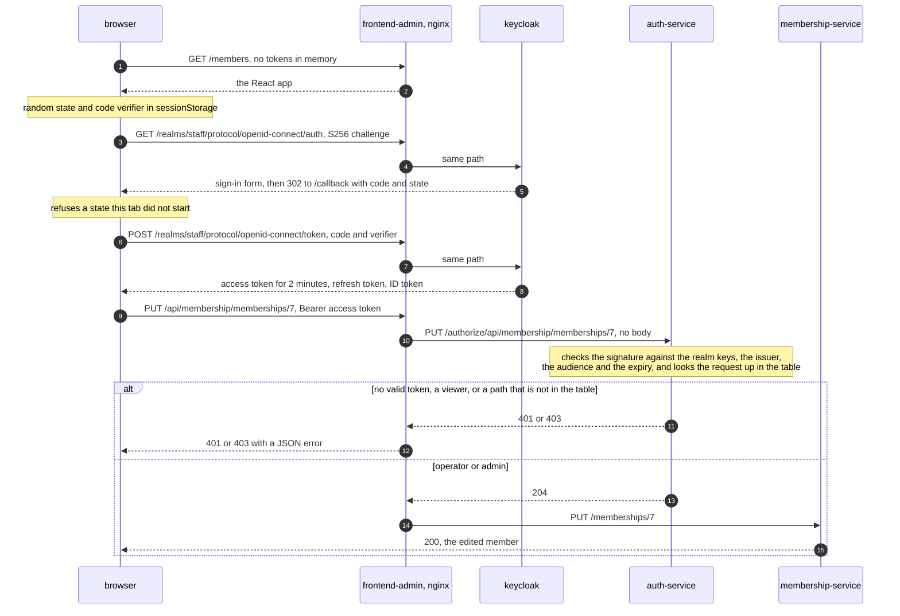
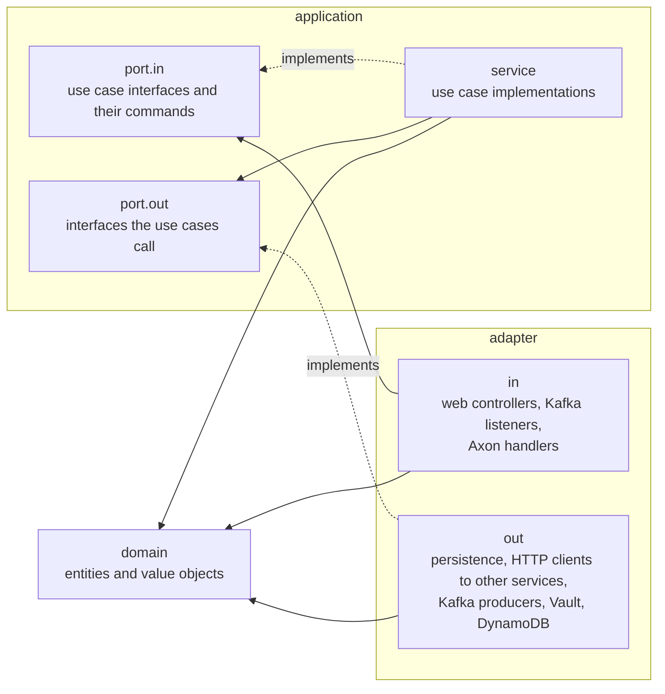
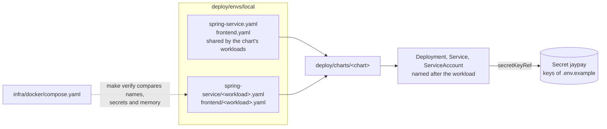

# Architecture notes

The [root README](../README.md) shows the services, the messaging and the observability stack. This page follows one request through the saga top-up and shows the layers inside each service.

## Money top-up through the saga

`POST /money/increase-eda` on money-service tops a wallet up through Axon. `make smoke` calls it through the customer site's proxy at `/api/money/money/increase-eda`. The top-up form on the customer site calls the synchronous `POST /money/increase` instead. money-service answers `increase-eda` as soon as it sends the first command. The rest of the flow runs on Axon commands and events, and a saga in money-service drives it. Every command and event below travels through Axon Server, which the diagram leaves out.

`POST /money/increase-async` reaches the same end through Kafka. money-service writes a task to `jaypay.task.topic` and blocks the request. task-consumer marks every subtask done and writes the result to `jaypay.task.result.topic`. When money-service reads the result, it adds the amount to the balance and answers.

`make smoke` runs both top-ups. It checks that the saga trace spans money-service and banking-service, and that the Kafka trace spans money-service and task-consumer.

## Admin console sign-in through Keycloak

Keycloak holds the staff accounts in the realm `staff`. The admin console is the public client `jaypay-admin-console` and signs staff in with the Authorization Code flow and PKCE (`S256`). Only the JavaScript bundle, the callback page and the Keycloak sign-in pages load without a staff account.

### One origin for the browser and the containers

The browser reaches Keycloak only through the admin site: `frontend-admin` proxies `/realms/staff/` and `/resources/` to `JAYPAY_KEYCLOAK_URL` and answers 404 to any other `/realms/` path, so the master realm is not reachable on 8091. `KC_HOSTNAME` is the full URL of the admin site, `http://localhost:8091` in Compose and `http://admin.jaypay.localhost:8480` in the local cluster. Keycloak then writes the same issuer, `<admin site>/realms/staff`, into every token, whichever address a request came in on.

auth-service checks that issuer through `STAFF_ISSUER_URI`, but fetches the realm keys from `STAFF_JWK_SET_URI`, the address of Keycloak inside the network, `http://keycloak:8080/realms/staff/protocol/openid-connect/certs`. The issuer is never fetched, so it does not have to resolve inside a container. The callback URI `/callback` and the post sign-out URI `/signed-out` are relative to `KC_HOSTNAME`, and the browser never makes a cross-origin call, so the client needs no CORS rule.

The Keycloak admin console has its own hostname, `KC_HOSTNAME_ADMIN`, `http://localhost:8092`. Compose publishes it on `127.0.0.1:8092` only. In the cluster it has no Ingress, and `kubectl port-forward service/keycloak 8092:8080` opens it.

### Tokens and the session

- The access and refresh tokens live in memory only, in the React Query cache. A reload or a new tab starts the Authorization Code flow again, and Keycloak's session cookie signs the tab in without the form while the session lasts.
- The console refreshes the tokens 30 seconds before the access token expires. Keycloak rotates the refresh token on each use. A failed refresh or a 401 from any `/api` request ends the session in the tab and shows a button to sign in again instead of redirecting at once.
- Signing out sends the tab to Keycloak's end-session endpoint with the ID token. Keycloak ends the session, so its refresh tokens stop working, and returns to `/signed-out`.
- A Keycloak session ends after 30 idle minutes or 8 hours.

### The decision in auth-service

- `StaffSecurityConfig` in auth-service holds the only decision table, as Spring Security `authorizeHttpRequests` rules: one line per method and path the admin console calls, the lowest role that may call it, and `denyAll` for everything else. `AdminConsoleGateTest` pins the table for no token and for each role, and the refusal of a token signed by another key, an expired token, another issuer, another audience and a customer token.
- auth-service is a Spring Security resource server. The realm roles `viewer`, `operator` and `admin` in the token's `realm_access.roles` become the roles of the table, and they form the hierarchy viewer < operator < admin through a Spring Security `RoleHierarchy`. A token with none of them opens nothing.
- The audience mapper of the client puts `jaypay-admin-console` into the access token's `aud`. Customer tokens from membership-service are HS256 with `JWT_SECRET` and no audience, so neither token opens the other site.
- auth-service checks `$request_uri` as the browser sent it. Spring Security's firewall refuses an encoded slash, backslash or dot, `;`, `//`, a dot segment and an encoded `%` with 403, so the path auth-service decides on is the path the upstream service receives. Tomcat in auth-service passes encoded slashes and backslashes through to the firewall instead of answering 400, because nginx `auth_request` turns any answer other than 2xx, 401 and 403 into 500. `AdminConsoleGateOverTomcatTest` sends these paths through a real Tomcat.
- auth-service does not ask Keycloak on every request. Disabling an account or taking a role away refuses its next sign-in and its next refresh at once, but an access token issued before keeps working until it expires. With the 2-minute lifetime and Spring Security's clock skew of 60 seconds, `make smoke` and a manual measurement saw the first 401 181 seconds after the account was disabled.

Spring Security stays in the adapters of auth-service, which keeps no database: `domain` holds `StaffRole`, and `adapter.in.web` holds the decision table and the token conversion. `SecurityStaysInAdaptersTest` fails when `domain` or `application` imports Spring Security.

## Layers inside a service

Each service follows the hexagonal dependency direction in [CLAUDE.md](../CLAUDE.md): `domain` ← `application` ← `adapter`. An arrow points from the code that depends to the code it depends on.

- `domain` imports neither `application` nor `adapter`.
- `application` reaches the outside only through its `port.in` and `port.out` interfaces.
- `adapter` turns HTTP requests, Kafka records and Axon messages into `port.in` calls, and implements `port.out` with JPA, HTTP clients, Kafka, Vault and the AWS SDK.

## Workloads on Kubernetes

[deploy/README.md](../deploy/README.md) packages the same thirteen workloads as Helm charts, and Keycloak with the other dependencies. Nothing is deployed from this repository yet. Each workload becomes a Deployment, a Service and a ServiceAccount with its Compose name, so `http://membership-service:8080` and the other service URLs keep working inside one namespace.

Two things differ from Compose:

- The two sites get their upstreams as full names such as `http://auth-service.jaypay.svc.cluster.local:8080`, because the nginx `resolver` ignores the search domains of the pod. The admin console's `auth_request` to auth-service uses the same name.
- Secret values come from the Secret `jaypay` instead of `infra/docker/.env`, under the same key names.
