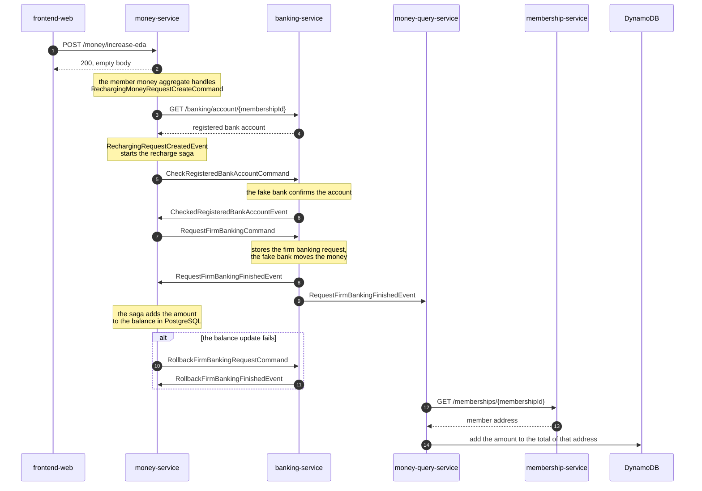
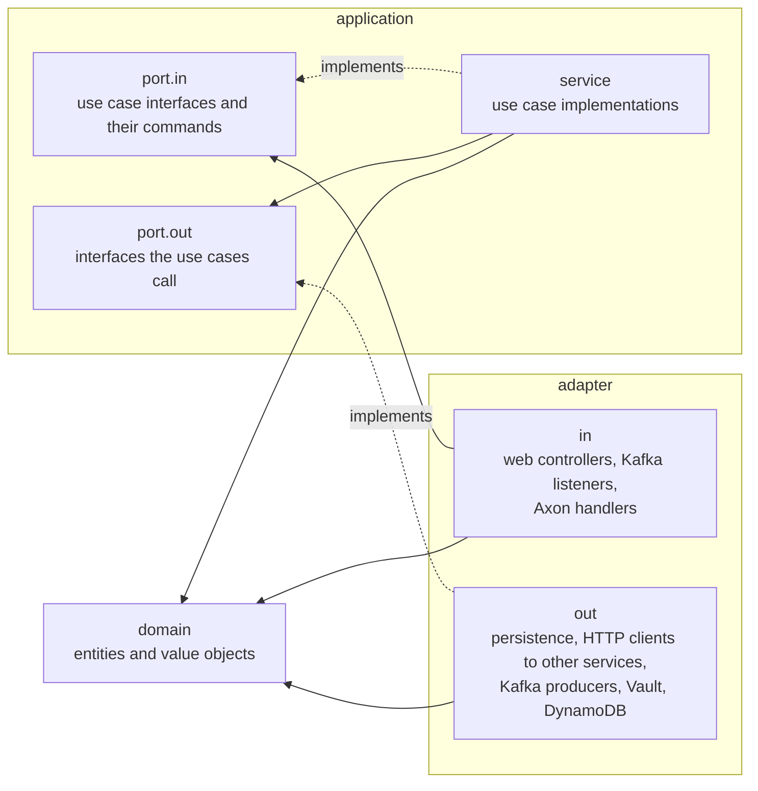

# Architecture notes

The [root README](../README.md) shows the services, the messaging and the observability stack. This page follows one request through the saga top-up and shows the layers inside each service.

## Money top-up through the saga

`POST /money/increase-eda` on money-service tops a wallet up through Axon. `make smoke` calls it through the customer site's proxy at `/api/money/money/increase-eda`. The top-up form on the customer site calls the synchronous `POST /money/increase` instead. money-service answers `increase-eda` as soon as it sends the first command. The rest of the flow runs on Axon commands and events, and a saga in money-service drives it. Every command and event below travels through Axon Server, which the diagram leaves out.

`POST /money/increase-async` reaches the same end through Kafka. money-service writes a task to `jaypay.task.topic` and blocks the request. task-consumer marks every subtask done and writes the result to `jaypay.task.result.topic`. When money-service reads the result, it adds the amount to the balance and answers.

`make smoke` runs both top-ups. It checks that the saga trace spans money-service and banking-service, and that the Kafka trace spans money-service and task-consumer.

## Layers inside a service

Each service follows the hexagonal dependency direction in [CLAUDE.md](../CLAUDE.md): `domain` ← `application` ← `adapter`. An arrow points from the code that depends to the code it depends on.

- `domain` imports neither `application` nor `adapter`.
- `application` reaches the outside only through its `port.in` and `port.out` interfaces.
- `adapter` turns HTTP requests, Kafka records and Axon messages into `port.in` calls, and implements `port.out` with JPA, HTTP clients, Kafka, Vault and the AWS SDK.
