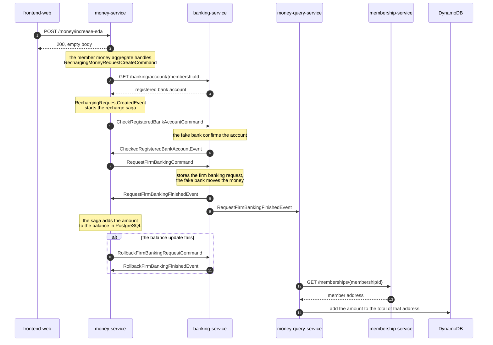
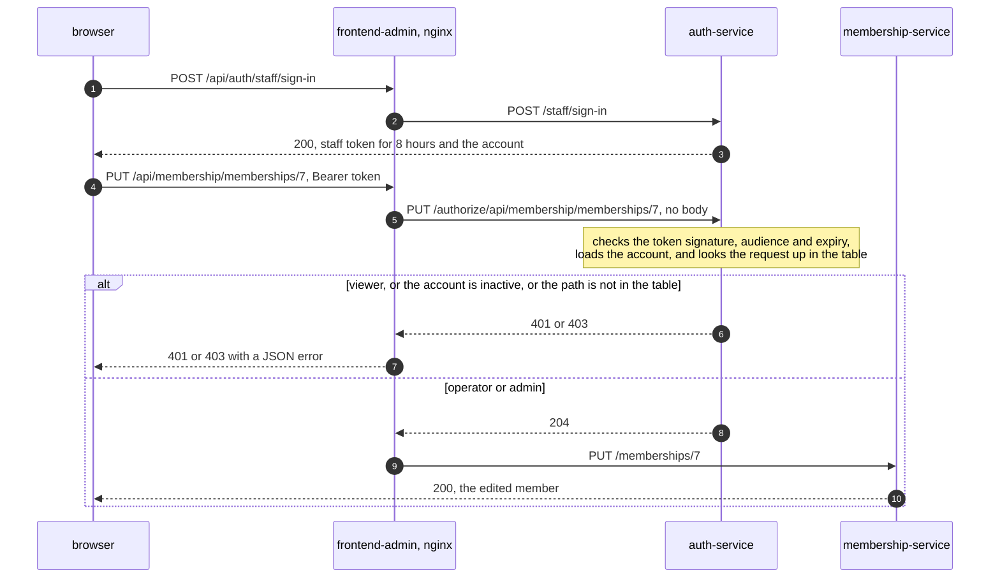
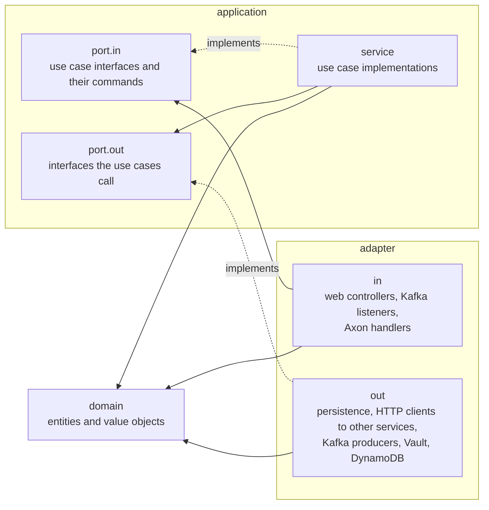

# Architecture notes

The [root README](../README.md) shows the services, the messaging and the observability stack. This page follows one request through the saga top-up and shows the layers inside each service.

## Money top-up through the saga

`POST /money/increase-eda` on money-service tops a wallet up through Axon. `make smoke` calls it through the customer site's proxy at `/api/money/money/increase-eda`. The top-up form on the customer site calls the synchronous `POST /money/increase` instead. money-service answers `increase-eda` as soon as it sends the first command. The rest of the flow runs on Axon commands and events, and a saga in money-service drives it. Every command and event below travels through Axon Server, which the diagram leaves out.

`POST /money/increase-async` reaches the same end through Kafka. money-service writes a task to `jaypay.task.topic` and blocks the request. task-consumer marks every subtask done and writes the result to `jaypay.task.result.topic`. When money-service reads the result, it adds the amount to the balance and answers.

`make smoke` runs both top-ups. It checks that the saga trace spans money-service and banking-service, and that the Kafka trace spans money-service and task-consumer.

## Admin console request through auth-service

Only the sign-in screen and the JavaScript bundle load without a staff account. Every `/api/<service>/` request of the admin console passes nginx `auth_request` first: nginx sends the original method, path and headers, without the body, to `/authorize/<original path>` on auth-service and forwards the request only when auth-service answers 204.

- `StaffSecurityConfig` in auth-service holds the only decision table, as Spring Security `authorizeHttpRequests` rules: one line per method and path the admin console calls, the lowest role that may call it, and `denyAll` for everything else. `AdminConsoleGateTest` pins the table for no token and for each role.
- The roles form the hierarchy viewer < operator < admin through a Spring Security `RoleHierarchy`.
- auth-service checks `$request_uri` as the browser sent it. Spring Security's firewall refuses an encoded slash, backslash or dot, `;`, `//`, a dot segment and an encoded `%` with 403, so the path auth-service decides on is the path the upstream service receives. Tomcat in auth-service passes encoded slashes and backslashes through to the firewall instead of answering 400, because nginx `auth_request` turns any answer other than 2xx, 401 and 403 into 500. `AdminConsoleGateOverTomcatTest` sends these paths through a real Tomcat.
- auth-service loads the account on every check, so a deactivation or a role change applies at once to tokens issued before it.
- Staff tokens are HS256 JWTs signed with `STAFF_JWT_SECRET`, with the audience `jaypay-admin-console`. Customer tokens from membership-service use `JWT_SECRET` and carry no audience, so neither token opens the other site.
- The token carries the factors the sign-in proved, today `FACTOR_PASSWORD`, as Spring Security 7 `FactorGrantedAuthority` values, and the sign-in answer has a `status` of `SIGNED_IN`. A second factor for accounts with the MFA flag can add another status and a `requireFactors` rule without changing the shape.

Spring Security stays in the adapters of auth-service. `domain` holds `StaffAccount`, `StaffRole` and `PasswordPolicy`, the list of password rules. `adapter.in.web` holds the decision table, the sign-in through `DaoAuthenticationProvider` and the token check. `adapter.out.password` and `adapter.out.token` wrap `PasswordEncoder` and `JwtEncoder` behind the `PasswordHashing` and `StaffTokenIssuer` ports. `SecurityStaysInAdaptersTest` fails when `domain` or `application` imports Spring Security.

## Layers inside a service

Each service follows the hexagonal dependency direction in [CLAUDE.md](../CLAUDE.md): `domain` ← `application` ← `adapter`. An arrow points from the code that depends to the code it depends on.

- `domain` imports neither `application` nor `adapter`.
- `application` reaches the outside only through its `port.in` and `port.out` interfaces.
- `adapter` turns HTTP requests, Kafka records and Axon messages into `port.in` calls, and implements `port.out` with JPA, HTTP clients, Kafka, Vault and the AWS SDK.
